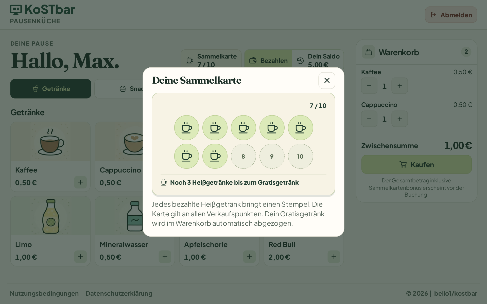

# KoSTbar

KoSTbar ist eine selbst gehostete Selbstbedienungskasse für den Pausenshop. Am Touchterminal melden sich Nutzer mit NFC-Karte oder PIN an, wählen Produkte und buchen den Einkauf auf ihr Kassenkonto. Das Kassen-Team verwaltet Sortiment, Zahlungen und Auswertungen im Browser.


## Funktionen

- Anmeldung per NFC und optional per PIN, mit persönlichem Saldo und Buchungsverlauf
- Barzahlung auf Vertrauensbasis und optionale PayPal-Zahlung mit manueller Bestätigung
- Digitale Sammelkarte für Heißgetränke mit einem Gratisgetränk nach zehn Stempeln
- Mehrere Verkaufspunkte mit eigenem Sortiment und einer Terminal-Vorschau zum Simulieren von Einkäufen
- Verwaltung mit getrennten Admin-Rollen, Journal, Monatsauswertungen und Exporten

### Verwaltung


### Sammelkarte am Terminal



Die Screenshots zeigen ausschließlich fiktive Beispieldaten.

## Hardware

| Einsatz | Komponente | Referenzkonfiguration |
| --- | --- | --- |
| Zentraler Betrieb | Docker-fähiges NAS | QNAP TVS-872XT mit QTS 5.2.11.3683 Build 20261114 und Container Station oder Synology DS720+ mit DSM 7.4.1-90080 Update 2 und Container Manager |
| Je Terminal | Raspberry Pi 5 | Raspberry Pi OS 64-Bit mit Desktop, microSD-Karte (32 GB empfohlen), USB-C-Netzteil (27 W empfohlen) |
| Je Terminal | Touchdisplay | Raspberry Pi Touch Display 2, 10″, per DSI, im Querformat mit 1920 × 1200 Pixeln |
| Je Terminal | USB-NFC-Leser und Karten | ACS ACR1552U-M1 im PC/SC-Modus, mit kompatiblen NFC-Karten oder Anhängern |
| Optional je Terminal | Gehäuse und Halteschiene | 3D-gedruckter Standfuß und Displaygehäuse. Druckprofil und Montage stehen in der [Hardware-Anleitung](docs/HARDWARE.md). |

NAS, Terminals und der Admin-Rechner benötigen Netzwerkzugang, DNS und eine vertrauenswürdige HTTPS-Verbindung zum NAS. Die [Terminal-Anleitung](docs/TERMINALS.md) beschreibt auch WPA2-Enterprise mit PEAP/MSCHAPv2, RADIUS-Gerätekonten und Prüfung des RADIUS-Serverzertifikats.


*Visualisierung des Terminals mit 3D-gedrucktem Gehäuse und eingebettetem Screenshot aus v38.0.1.*

## Installation

| | QNAP | Synology |
| --- | --- | --- |
| Anleitung | [QNAP einrichten](QNAP/README.md) | [Synology einrichten](Synology/README.md) |
| HTTPS | Caddy auf der NAS-LAN-IP mit eigener CA | DSM Reverse Proxy vor internem Caddy |
| Adresse | Vorgabe `https://kostbar.internal.lan:18443` | Eigene HTTPS-Adresse bei `--origin` |

### Neuinstallation

```bash
git clone https://github.com/beilo1/kostbar.git
cd kostbar
```

1. Das [gemeinsame App-Image bauen](#app-image-bereitstellen).
2. Nach der passenden NAS-Anleitung eine neue Konfiguration erzeugen. Der Beispiel-Projektname für Docker Compose ist `kostbar`. Bei einer zusätzlichen Instanz einen eigenen Projektnamen sowie passende Bind-Adressen, Ports und Proxy-Ziele verwenden.
3. Den Verkaufspunkt koppeln und die [Erstabnahme](docs/BETRIEB.md#erstabnahme) durchführen. `schema-status` zeigt die Versionen **1 bis 6**, beginnend mit `v35_baseline`.
4. Vor der Freigabe die Datenschutzerklärung an die tatsächliche Umgebung anpassen und veröffentlichen. [`privacy.md`](privacy.md) ist die Ausgangsvorlage. Die [Betriebsanleitung](docs/BETRIEB.md) erläutert die Bearbeitung in der Verwaltung.

Weitere Terminals legst du als Super-Admin unter **Verkauf → Verkaufspunkte** an. Lade das jeweilige private Geräteprofil herunter, richte den Pi ein und bestätige dessen Kopplungscode. Produkte weist du unter **Sortiment** zu.

### App-Image bereitstellen

Beide Deployment-Varianten verwenden standardmäßig das gemeinsame Image `kostbar-app:40.0.2`. Führe den Build im Hauptordner für die Architektur des Ziel-NAS aus. Für ein x86-64-NAS kann bei einem Build auf ARM beispielsweise `--platform linux/amd64` verwendet werden, sofern der Builder diese Zielplattform unterstützt.

```bash
docker build --pull -t kostbar-app:40.0.2 .
docker image save -o kostbar-app-40.0.2.tar kostbar-app:40.0.2
```

Die Tar-Datei je Zielsystem einmal importieren. Für die Erstinstallation müssen auch `postgres:17-bookworm` und `caddy:2-alpine` lokal geladen oder erreichbar sein.

```bash
sudo docker image load -i kostbar-app-40.0.2.tar
sudo docker image inspect kostbar-app:40.0.2 --format '{{.Id}} {{.Os}}/{{.Architecture}}'
```

Alternativ die Image-Referenz einer Registry als `KOSTBAR_APP_IMAGE` in der jeweiligen `.env` setzen und im NAS-Unterordner `sudo docker compose -p kostbar pull app` ausführen. Eine Referenz mit Digest legt den Build eindeutig fest.

### Upgrade einer bestehenden Installation

Für eine laufende v39- oder v40-Instanz genügt es, auf das App-Image 40.0.2 zu wechseln. Die Schritte für QNAP und Synology sowie den Rückweg beschreibt [Update auf v40](docs/UPDATE-v40.md).

Falls auf einem Terminal noch ein Pi-Installer vor v38.2 läuft, siehe [Terminal-Aktualisierung aus v38.2](docs/UPDATE-v38.2.md#3-bestehenden-raspberry-pi-aktualisieren). Beim Upgrade von v35 ergänzt die Anwendung weiterhin die Datenbankversionen 5 (`retired_terminals`) und 6 (`paypal_recipient`). Für eine Rückkehr zu v35 ist die vorher gesicherte Datenbank erforderlich.

## Entwicklung und Lizenz

- [Isolierte Python-, PostgreSQL- und JavaScript-Tests](tests/README.md)
- [Betrieb, Datensicherung und Abnahme](docs/BETRIEB.md)
- [MIT-Lizenz](LICENSE). Die mitgelieferten Schriften Fraunces und Plus Jakarta Sans stehen unter der [SIL Open Font License 1.1](licenses/fonts/).

Die Browser-Oberflächen liegen in `static/`, der Raspberry-Pi-Installer in `pi/`. `server.py`, `web.py`, `store.py` und `finance.py` bilden die Python-Anwendung mit PostgreSQL.
